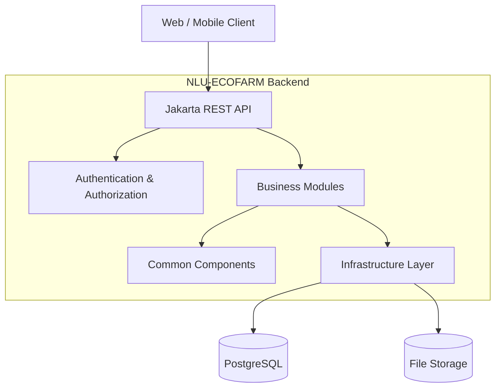
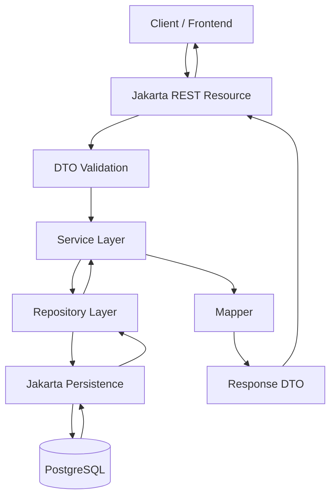
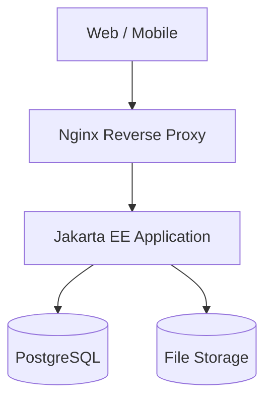

# NLU-ECOFARM – Jakarta EE Backend Architecture

**Phiên bản:** 1.0  
**Backend:** Jakarta EE 10  
**Kiến trúc:** Modular Monolith + Layered Architecture  
**Database:** PostgreSQL  
**Build Tool:** Maven  
**Runtime:** Payara Server / WildFly

---

## 1. Tổng quan

NLU-ECOFARM sử dụng kiến trúc Modular Monolith kết hợp Layered Architecture để xây dựng hệ thống backend.

Mục tiêu:

- Phân chia hệ thống thành các module nghiệp vụ độc lập.
- Tách biệt API, nghiệp vụ và truy cập dữ liệu.
- Dễ dàng bảo trì, kiểm thử và mở rộng.
- Hạn chế sự phụ thuộc giữa các module.
- Hỗ trợ triển khai bằng Docker.
- Thuận tiện tích hợp với Web Frontend và Mobile App.

### 1.1. Kiến trúc tổng thể



---

## 2. Cấu trúc thư mục tổng thể

```text
NLU-ECOFARM/
│
├── ecofarm-core/
│   ├── pom.xml
│   ├── Dockerfile
│   ├── README.md
│   ├── .env.example
│   │
│   └── src/
│       ├── main/
│       │   │
│       │   ├── java/
│       │   │   └── vn/
│       │   │       └── edu/
│       │   │           └── nlu/
│       │   │               └── ecofarm/
│       │   │                   │
│       │   │                   ├── config/
│       │   │                   │
│       │   │                   ├── common/
│       │   │                   │   ├── constant/
│       │   │                   │   ├── exception/
│       │   │                   │   ├── response/
│       │   │                   │   ├── validation/
│       │   │                   │   ├── pagination/
│       │   │                   │   └── util/
│       │   │                   │
│       │   │                   ├── infrastructure/
│       │   │                   │   ├── persistence/
│       │   │                   │   │   ├── entity/
│       │   │                   │   │   ├── repository/
│       │   │                   │   │   └── mapper/
│       │   │                   │   ├── security/
│       │   │                   │   ├── storage/
│       │   │                   │   ├── email/
│       │   │                   │   └── scheduler/
│       │   │                   │
│       │   │                   ├── modules/
│       │   │                   │   ├── auth/
│       │   │                   │   ├── users/
│       │   │                   │   ├── farms/
│       │   │                   │   ├── greenhouses/
│       │   │                   │   ├── crops/
│       │   │                   │   ├── varieties/
│       │   │                   │   ├── cultivation/
│       │   │                   │   ├── inventory/
│       │   │                   │   ├── production/
│       │   │                   │   ├── harvesting/
│       │   │                   │   ├── quality/
│       │   │                   │   ├── packaging/
│       │   │                   │   ├── orders/
│       │   │                   │   ├── customers/
│       │   │                   │   ├── reports/
│       │   │                   │   └── audit/
│       │   │                   │
│       │   │                   └── api/
│       │   │                       ├── ApiApplication.java
│       │   │                       └── ApiExceptionMapper.java
│       │   │
│       │   ├── resources/
│       │   │   ├── META-INF/
│       │   │   │   └── persistence.xml
│       │   │   ├── db/
│       │   │   │   ├── migration/
│       │   │   │   └── seed/
│       │   │   ├── application.properties
│       │   │   └── logback.xml
│       │   │
│       │   └── webapp/
│       │       └── WEB-INF/
│       │           └── beans.xml
│       │
│       └── test/
│           ├── java/
│           │   └── vn/edu/nlu/ecofarm/
│           │       ├── unit/
│           │       ├── integration/
│           │       └── resource/
│           │
│           └── resources/
│               └── application-test.properties
│
├── database/
│   ├── schema/
│   ├── migration/
│   ├── seed/
│   └── backup/
│
├── infrastructure/
│   ├── docker/
│   ├── nginx/
│   ├── scripts/
│   └── monitoring/
│
├── docs/
│   ├── architecture/
│   ├── api/
│   ├── database/
│   └── deployment/
│
├── docker-compose.yml
└── README.md
```

---

## 3. Chi tiết các thành phần

### 3.1. Config

Thư mục `config/` chứa các cấu hình dùng chung của ứng dụng.

| File | Trách nhiệm |
|---|---|
| ApplicationConfig.java | Cấu hình Jakarta REST |
| CorsConfig.java | Cấu hình CORS |
| OpenApiConfig.java | Cấu hình OpenAPI nếu sử dụng |
| SecurityConfig.java | Cấu hình bảo mật |

### 3.2. Common

Thư mục `common/` chứa các thành phần được sử dụng chung giữa các module.

| Thư mục | Trách nhiệm |
|---|---|
| constant/ | Các hằng số hệ thống |
| exception/ | Định nghĩa ngoại lệ |
| response/ | Cấu trúc API Response |
| validation/ | Các quy tắc kiểm tra dữ liệu |
| pagination/ | Xử lý phân trang |
| util/ | Các hàm tiện ích |

Ví dụ API Response:

```json
{
  "success": true,
  "message": "Request successful",
  "data": {},
  "timestamp": "2026-11-04T10:30:00"
}
```

### 3.3. Infrastructure

Thư mục `infrastructure/` chịu trách nhiệm kết nối với các thành phần bên ngoài.

| Thư mục | Trách nhiệm |
|---|---|
| persistence/ | Làm việc với PostgreSQL |
| security/ | Xác thực và phân quyền |
| storage/ | Quản lý tệp tin |
| email/ | Gửi email |
| scheduler/ | Các tác vụ định kỳ |

---

## 4. Cấu trúc module nghiệp vụ

Mỗi module nghiệp vụ được chia thành các thành phần riêng biệt.

Ví dụ module `greenhouses`:

```text
greenhouses/
│
├── resource/
│   └── GreenhouseResource.java
│
├── service/
│   ├── GreenhouseService.java
│   └── GreenhouseServiceImpl.java
│
├── dto/
│   ├── request/
│   │   ├── CreateGreenhouseRequest.java
│   │   └── UpdateGreenhouseRequest.java
│   │
│   └── response/
│       └── GreenhouseResponse.java
│
└── mapper/
    └── GreenhouseMapper.java
```

### 4.1. Resource Layer

Nhiệm vụ:

- Tiếp nhận HTTP Request.
- Kiểm tra dữ liệu đầu vào.
- Gọi Service xử lý nghiệp vụ.
- Trả HTTP Response.

Sử dụng Jakarta REST.

### 4.2. Service Layer

Nhiệm vụ:

- Xử lý nghiệp vụ.
- Kiểm tra các điều kiện nghiệp vụ.
- Điều phối các thao tác dữ liệu.
- Quản lý transaction khi cần thiết.

Sử dụng Jakarta CDI và Jakarta Transactions.

### 4.3. DTO Layer

Nhiệm vụ:

- Định nghĩa cấu trúc Request.
- Định nghĩa cấu trúc Response.
- Không để Entity được trả trực tiếp ra API.
- Kiểm tra dữ liệu đầu vào bằng Jakarta Bean Validation.

### 4.4. Mapper Layer

Nhiệm vụ:

- Chuyển đổi Entity sang DTO.
- Chuyển đổi DTO sang Entity khi phù hợp.
- Chuẩn hóa dữ liệu trước khi trả về API.

Có thể sử dụng MapStruct hoặc viết mapper thủ công.

---

## 5. Các module nghiệp vụ

| Module | Chức năng |
|---|---|
| auth | Đăng nhập, đăng xuất, xác thực |
| users | Quản lý người dùng |
| farms | Quản lý trang trại |
| greenhouses | Quản lý nhà kính |
| crops | Quản lý cây trồng |
| varieties | Quản lý giống cây |
| cultivation | Quản lý quy trình canh tác |
| inventory | Quản lý kho và vật tư |
| production | Quản lý sản xuất |
| harvesting | Quản lý thu hoạch |
| quality | Kiểm tra và quản lý chất lượng |
| packaging | Quản lý đóng gói |
| orders | Quản lý đơn hàng |
| customers | Quản lý khách hàng |
| reports | Thống kê và báo cáo |
| audit | Nhật ký hoạt động |

Các module trên là phân chia đề xuất. Cần đối chiếu với ERD và nghiệp vụ thực tế trước khi triển khai.

---

## 6. Luồng xử lý Request



### Ví dụ xử lý tạo nhà kính

Request:

```http
POST /api/v1/greenhouses
Content-Type: application/json
```

Request Body:

```json
{
  "farmId": 1,
  "name": "Greenhouse A",
  "location": "Zone A",
  "area": 500
}
```

GreenhouseResource.java:

```java
@Path("/greenhouses")
@Produces(MediaType.APPLICATION_JSON)
@Consumes(MediaType.APPLICATION_JSON)
@RequestScoped
public class GreenhouseResource {

    @Inject
    private GreenhouseService greenhouseService;

    @POST
    public Response create(CreateGreenhouseRequest request) {

        GreenhouseResponse response =
                greenhouseService.create(request);

        return Response.status(Response.Status.CREATED)
                .entity(response)
                .build();
    }
}
```

GreenhouseService.java:

```java
public interface GreenhouseService {

    GreenhouseResponse create(
        CreateGreenhouseRequest request
    );

    GreenhouseResponse findById(Long id);

    List<GreenhouseResponse> findAll();

    GreenhouseResponse update(
        Long id,
        UpdateGreenhouseRequest request
    );

    void delete(Long id);
}
```

---

## 7. Quy ước API

Sử dụng RESTful API và versioning.

Base URL:

```text
/api/v1
```

Ví dụ:

| HTTP Method | Endpoint | Chức năng |
|---|---|---|
| GET | /greenhouses | Danh sách nhà kính |
| GET | /greenhouses/{id} | Chi tiết nhà kính |
| POST | /greenhouses | Tạo nhà kính |
| PUT | /greenhouses/{id} | Cập nhật nhà kính |
| DELETE | /greenhouses/{id} | Xóa nhà kính |

Quy ước:

- Sử dụng danh từ số nhiều cho tài nguyên.
- Sử dụng HTTP Status Code phù hợp.
- Hỗ trợ phân trang cho danh sách lớn.
- Không trả thông tin nhạy cảm.
- Chuẩn hóa cấu trúc Response.
- Sử dụng DTO cho Request và Response.

---

## 8. Database và Persistence

Sử dụng PostgreSQL làm hệ quản trị cơ sở dữ liệu.

Các thành phần:

| Công nghệ | Chức năng |
|---|---|
| PostgreSQL | Lưu trữ dữ liệu |
| Jakarta Persistence | ORM |
| Flyway | Quản lý migration |
| JDBC Driver | Kết nối PostgreSQL |

### 8.1. Entity

Các Entity được ánh xạ với bảng dữ liệu thông qua Jakarta Persistence.

Ví dụ:

```java
@Entity
@Table(name = "greenhouses")
public class Greenhouse {

    @Id
    @GeneratedValue(strategy = GenerationType.IDENTITY)
    private Long id;

    @Column(name = "name", nullable = false)
    private String name;

    @Column(name = "is_active")
    private Boolean isActive;

    @Column(name = "version")
    private Integer version;

    @Column(name = "create_at")
    private LocalDateTime createAt;

    @Column(name = "update_at")
    private LocalDateTime updateAt;
}
```

Lưu ý: Tên cột trong Entity phải khớp với schema PostgreSQL thực tế. Nếu sử dụng `TIMESTAMPTZ`, nên cân nhắc `OffsetDateTime` thay vì `LocalDateTime`.

### 8.2. Migration

Ví dụ cấu trúc:

```text
resources/
└── db/
    └── migration/
        ├── V1__create_initial_schema.sql
        ├── V2__add_user_roles.sql
        ├── V3__add_greenhouse_indexes.sql
        └── V4__update_audit_fields.sql
```

Không chỉnh sửa migration đã chạy trên môi trường dùng chung. Tạo migration mới cho các thay đổi tiếp theo.

---

## 9. Công nghệ sử dụng

| Thành phần | Công nghệ đề xuất |
|---|---|
| Backend Framework | Jakarta EE 10 |
| REST API | Jakarta REST |
| Dependency Injection | Jakarta CDI |
| ORM | Jakarta Persistence |
| Validation | Jakarta Bean Validation |
| Transaction | Jakarta Transactions |
| JSON | Jakarta JSON-B |
| Security | Jakarta Security |
| Database | PostgreSQL |
| Migration | Flyway |
| Build | Maven |
| Runtime | Payara Server / WildFly |
| Container | Docker |
| Reverse Proxy | Nginx |
| API Documentation | OpenAPI |

Lưu ý: Runtime cần tương thích với phiên bản Jakarta EE được chọn. Không trộn dependency `javax.*` cũ với `jakarta.*`.

---

## 10. Quy tắc phát triển

### 10.1. Quy tắc đặt tên

| Thành phần | Quy tắc | Ví dụ |
|---|---|---|
| Package | lowercase | greenhouses |
| Class | PascalCase | GreenhouseService |
| Method | camelCase | findById() |
| Constant | UPPER_SNAKE_CASE | MAX_PAGE_SIZE |
| Database table | snake_case | greenhouses |
| Database column | snake_case | create_at |
| REST endpoint | kebab-case hoặc danh từ số nhiều | /greenhouses |

### 10.2. Quy tắc kiến trúc

1. Resource không chứa nghiệp vụ phức tạp.
2. Service không phụ thuộc trực tiếp vào HTTP Request/Response.
3. Không trả Entity trực tiếp qua API.
4. Các module không truy cập tùy tiện vào lớp nội bộ của module khác.
5. Transaction phải được quản lý rõ ràng.
6. Xử lý ngoại lệ tập trung.
7. Kiểm tra dữ liệu bằng Bean Validation.
8. Không hardcode mật khẩu, API Key hoặc thông tin kết nối.
9. Có unit test cho nghiệp vụ quan trọng.
10. Có integration test cho các thao tác cơ sở dữ liệu quan trọng.

---

## 11. Kiểm thử

Phân chia kiểm thử:

```text
src/test/java/vn/edu/nlu/ecofarm/
│
├── unit/
│   ├── service/
│   └── mapper/
│
├── integration/
│   ├── repository/
│   └── database/
│
└── resource/
    └── api/
```

| Loại kiểm thử | Mục tiêu |
|---|---|
| Unit Test | Kiểm tra nghiệp vụ độc lập |
| Integration Test | Kiểm tra kết nối và truy vấn database |
| API Test | Kiểm tra REST API |
| Security Test | Kiểm tra xác thực và phân quyền |

---

## 12. Docker và triển khai

Các thành phần triển khai:

```text
infrastructure/
│
├── docker/
│   ├── Dockerfile
│   └── docker-compose.yml
│
├── nginx/
│   └── nginx.conf
│
├── scripts/
│   ├── start.sh
│   ├── stop.sh
│   ├── backup.sh
│   └── migrate.sh
│
└── monitoring/
    └── README.md
```

Sơ đồ triển khai:



---

## 13. Kết luận

NLU-ECOFARM sử dụng kiến trúc Modular Monolith kết hợp Layered Architecture trên nền tảng Jakarta EE.

Kiến trúc này giúp:

- Tổ chức code theo nghiệp vụ.
- Tách biệt các tầng xử lý.
- Dễ dàng kiểm thử và bảo trì.
- Giảm sự phụ thuộc giữa các module.
- Có khả năng mở rộng khi hệ thống phát triển.

Trong giai đoạn đầu, nên triển khai theo một ứng dụng backend thống nhất thay vì chia nhỏ thành Microservices. Khi quy mô và nhu cầu vận hành thực tế tăng lên, có thể xem xét tách các module thành dịch vụ độc lập.